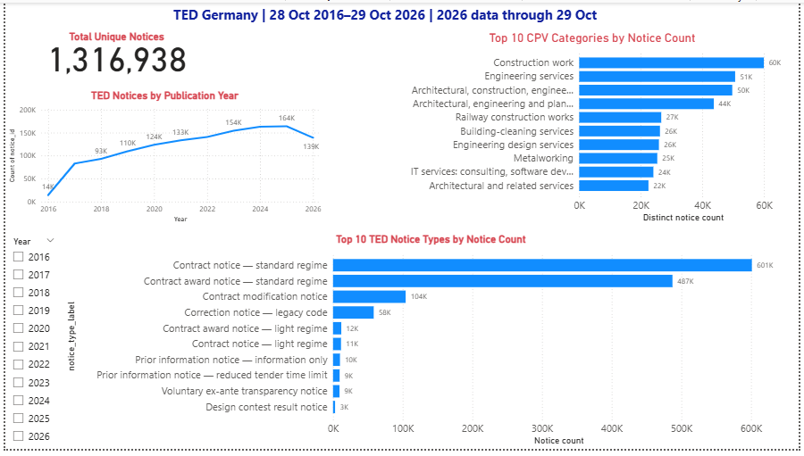
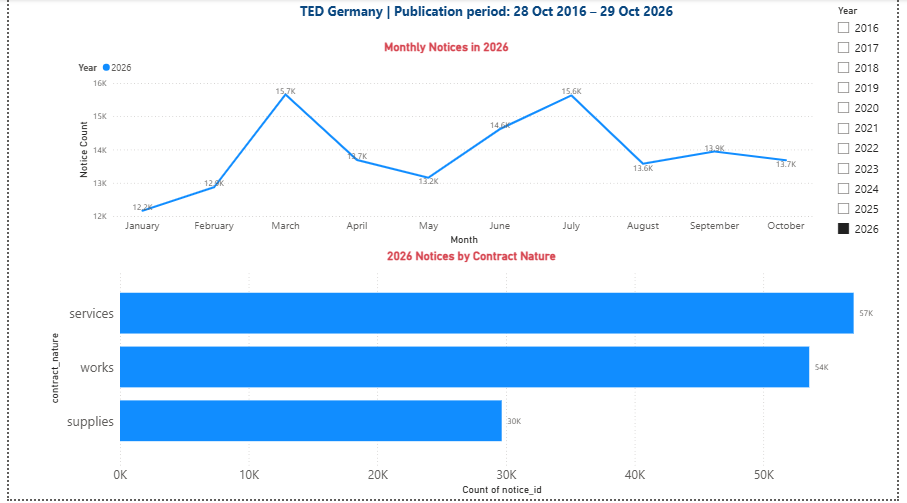

# German Public-Sector Digital Demand Intelligence

A portfolio analytics project exploring published public procurement demand in Germany, with an initial focus on digital-service opportunities. It combines TED notice data, a Python ingestion workflow, a MySQL relational model, and an interactive Power BI report.

## Project question

**How can published procurement notices help identify recurring buyers, categories, and changes in Germany's public-sector digital-service demand?**

## Purpose and intended use

This project examines published procurement notices to make patterns in buyers, categories, and publication timing easier to explore. The report is intended for analysts and public-sector stakeholders interested in Germany's published procurement demand. It makes the data scope, measure definitions, and source coverage explicit.

## Current results

- **TED scope:** German buyers; publication dates from **2016-10-28 through 2026-10-29** (inclusive).
- **Loaded TED dataset:** **1,316,938 distinct notices** in the local MySQL database.
- **Dashboard:** The two-page Power BI report includes a distinct-notice KPI, annual and monthly publication trends, the top 10 CPV categories, TED notice types with readable labels, and notice counts by contract nature.
- **Contract nature:** A MySQL view normalizes lot-level JSON values into distinct notice–contract-nature pairs. A notice is counted once within each nature category; categories can overlap.
- **Time coverage:** 2026 is partial through 29 October.
- **DÖE staging:** The September 2026 DÖE export is loaded into local MySQL staging tables. The raw `doe_raw_notice` and `doe_raw_purpose` tables are being explored in Power Query; DÖE has not been integrated into the TED analytical model or report. See [DÖE staging and Power Query status](docs/doe-staging-and-power-query.md).
- **Repository contents:** reusable starter SQL, project documentation, and selected dashboard screenshots are committed. The working ingestion script, populated database, and Power BI report remain local.

See the [Power BI dashboard notes](docs/powerbi-dashboard.md) and [implementation status](docs/implementation-status.md) for details.

## Dashboard preview

### Market Overview

### Time & Contract Analysis

## Data flow

`TED API → Python → MySQL → Power BI Desktop`

TED is the source for the current report. DÖE is in a separate local staging and Power Query exploration workflow; it is not yet part of the report model. Python retrieves TED notices using iteration-token pagination and loads structured data into MySQL.

## Skills demonstrated

- Public API data retrieval and token-based pagination
- Python data processing and MySQL Connector
- Relational schema design, keys, and SQL
- Power BI data modeling, filtering, and time-series reporting
- Source documentation, data coverage, and reproducible project communication

## Repository guide

- `docs/`: project scope, architecture, data sources, dashboard notes, and implementation status
- `code/database/schema/`: starter MySQL schema
- `code/analytics/metrics/`: metric definitions
- `assets/`: selected dashboard screenshots
- `powerbi/`: report documentation; the PBIX remains local
- `data/`: local workspace guidance; raw bulk data is not committed

## Reproducibility and data handling

The local database and Power BI file depend on the owner's Windows setup. Credentials, API continuation tokens, checkpoint files, and the bulk extract are intentionally excluded. Setup instructions and sanitized, reusable ingestion code are planned repository deliverables.

TED records represent published notices available in the selected source and query scope. The notice count is a count of distinct notice records, not a measure of contract value or total German public procurement.

## Sources and reuse

TED is the primary source for the current analysis. DÖE is being staged locally as a potential source for national below-threshold coverage; it is not yet combined with TED. Review the [data-source register](docs/data-sources.md) and [DÖE staging notes](docs/doe-staging-and-power-query.md) for source scope and data-handling details. Source data terms and attribution requirements should be checked before redistribution; this repository does not include the downloaded bulk data.

## Project documentation

- [Architecture](docs/architecture.md)
- [Implementation status](docs/implementation-status.md)
- [Project charter](docs/project-charter.md)
- [Data sources](docs/data-sources.md)
- [DÖE staging and Power Query](docs/doe-staging-and-power-query.md)
- [Power BI dashboard notes](docs/powerbi-dashboard.md)
