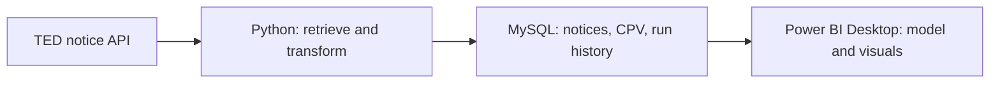
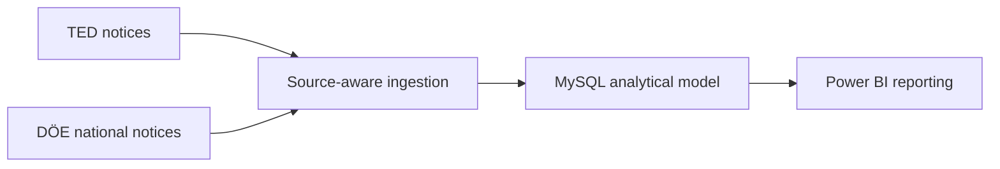

# Data Architecture

## Current local workflow

`TED notice API → Python ingestion → MySQL → Power BI Desktop`

The TED-to-MySQL data load is complete locally for the scope listed in [the data-source register](data-sources.md). Power BI is connected to the local database and an initial report is being built. The reusable ingestion script, populated database, and PBIX are not yet committed to GitHub.

## Planned extension

DÖE is a planned second stream for national German notices, including below-threshold procurement. It has not yet been integrated. Keep source identifiers and provenance so coverage and potential overlap between TED and DÖE can be assessed explicitly.

## Component responsibilities

### Source connectors and ingestion

The Python workflow sends the selected TED query, retrieves pages using iteration tokens, handles transient failures, and loads records to MySQL. The current working script remains local and must be reviewed for credentials and environment-specific configuration before it is added to the repository.

### MySQL model

The local database stores TED notices, CPV reference codes, notice-to-CPV relationships, and ingestion-run metadata. The repository's SQL is a starter schema and may need alignment with the final local implementation before it is used for a fresh setup.

The TED `contract_nature` value is a JSON array that may contain repeated lot-level entries. The Power Query attempt to normalize it produced a clean preview but failed during model apply. The planned next step is a MySQL view with one distinct `notice_id`–contract-nature pair per row. The view and its relationship to the report have not yet been implemented or validated.

### Power BI

Power BI Desktop connects to the local MySQL instance and supports interactive analysis. The current report includes total distinct notices, CPV categories, annual publication trend, notice types with readable labels, and monthly trend with a year slicer. See [dashboard notes](powerbi-dashboard.md) for the purpose, metric definitions, and validation status.

## Data handling

Keep credentials, continuation tokens, checkpoint files, and the populated database outside version control. Document the extract period and source when sharing report outputs. See [implementation status](implementation-status.md) for local progress and remaining work.
