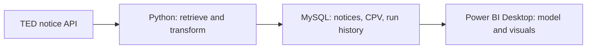
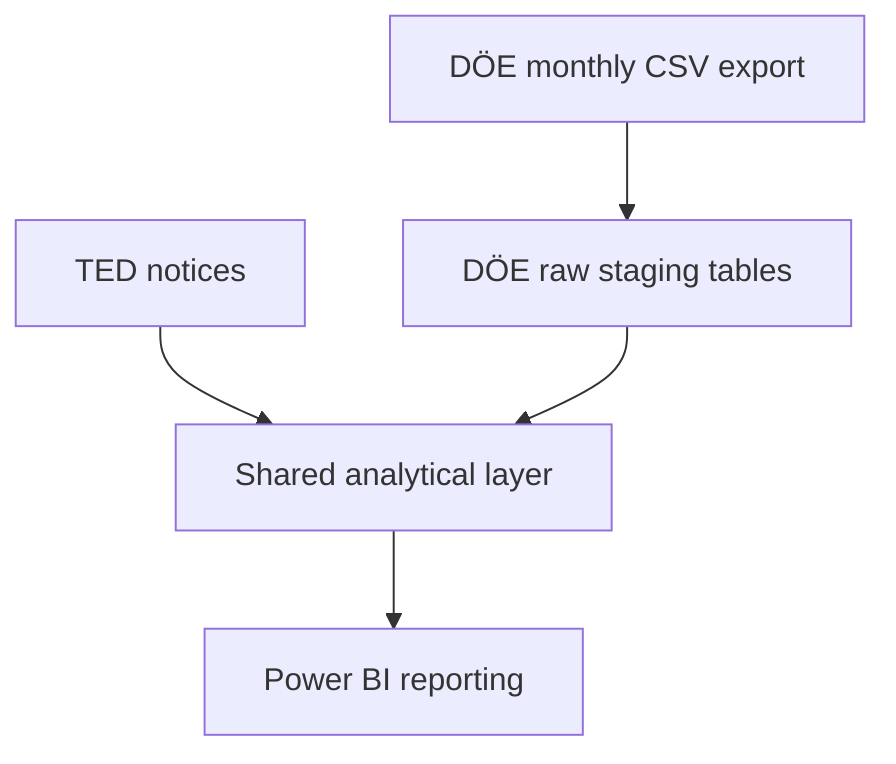

# Data Architecture

## Current local workflow

`TED notice API → Python ingestion → MySQL → Power BI Desktop`

The TED-to-MySQL data load is complete locally for the scope listed in [the data-source register](data-sources.md). Power BI is connected to the local database and an initial report is being built. The reusable ingestion script, populated database, and PBIX are not yet committed to GitHub.

## Source-aware extension

The DÖE monthly loader stages the normalized CSV files in separate `doe_raw_*` tables. Notice versions are preserved with the source key `(noticeIdentifier, noticeVersion)`. Threshold classification and cross-source deduplication are applied only in the shared analytical layer.

## Component responsibilities

### Source connectors and ingestion

The Python workflow sends the selected TED query, retrieves pages using iteration tokens, handles transient failures, and loads records to MySQL. The current working script remains local and must be reviewed for credentials and environment-specific configuration before it is added to the repository.

### MySQL model

The local database stores TED notices, CPV reference codes, notice-to-CPV relationships, and ingestion-run metadata. The repository's SQL is a starter schema and may need alignment with the final local implementation before it is used for a fresh setup.

The TED `contract_nature` value is a JSON array that may contain repeated lot-level entries. A MySQL view provides one distinct `notice_id`–contract-nature pair per row and is connected to the report.

### Power BI

Power BI Desktop connects to the local MySQL instance and supports interactive analysis. The current report includes total distinct TED notices, CPV categories, annual publication trend, notice types with readable labels, and monthly trend with a year slicer. The DÖE staged data is not yet part of the report measures. See [dashboard notes](powerbi-dashboard.md) for the purpose, metric definitions, and validation status.

## Data handling

Keep credentials, continuation tokens, checkpoint files, and the populated database outside version control. Document the extract period and source when sharing report outputs. See [implementation status](implementation-status.md) for local progress and remaining work.
