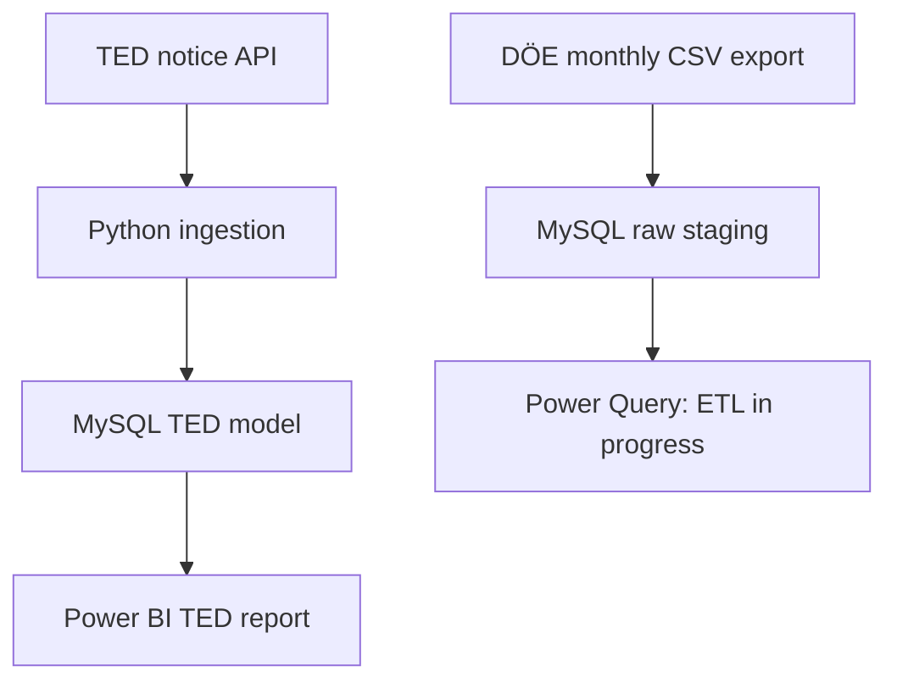

# Data Architecture

## Current local workflows

The established TED reporting workflow is:

`TED notice API → Python ingestion → MySQL → Power BI Desktop`

The separate DÖE staging workflow is currently:

`DÖE monthly CSV export → local MySQL raw staging tables → Power Query exploration`

TED powers the current Power BI report. DÖE is not yet integrated with the TED analytical model or report. The reusable ingestion script, populated database, raw DÖE files, and PBIX are not committed to GitHub.

See [the data-source register](data-sources.md) and [DÖE staging notes](doe-staging-and-power-query.md) for scope and status.

## Component responsibilities

### Source connectors and ingestion

The Python workflow sends the selected TED query, retrieves pages using iteration tokens, handles transient failures, and loads records to MySQL. The current working script remains local and must be reviewed for credentials and environment-specific configuration before it is added to the repository.

DÖE is currently loaded from its monthly export into local raw staging tables. Power Query is the intended place for column-by-column transformation and validation. Keep the raw data available and document each applied step so that transformations remain reviewable.

### MySQL model

The local TED database stores notices, CPV reference codes, notice-to-CPV relationships, and ingestion-run metadata. The repository's SQL is a starter schema and may need alignment with the final local implementation before it is used for a fresh setup.

DÖE raw staging tables are separate from the TED analytical tables. Amount fields have procedure-level and lot-level scopes; do not aggregate across both scopes without a source-backed rule. The current exploratory checks are documented in the DÖE staging notes.

The TED `contract_nature` value is a JSON array that may contain repeated lot-level entries. The MySQL view produces one distinct `notice_id`–contract-nature pair per row.

### Power BI

Power BI Desktop connects to the local MySQL instance. The current report includes total distinct TED notices, CPV categories, annual publication trend, notice types with readable labels, monthly trend with a year slicer, and contract-nature analysis. DÖE transformations and integration remain in progress and are not reflected in report visuals. See [dashboard notes](powerbi-dashboard.md) for metric definitions and validation status.

## Data handling

Keep credentials, continuation tokens, checkpoint files, the populated database, and raw DÖE exports outside version control. Document the extract period and source when sharing report outputs. See [implementation status](implementation-status.md) for local progress and remaining work.
