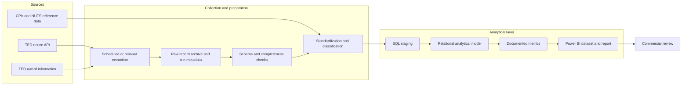

# Planned Data Architecture

## Overview

The architecture separates source retrieval, quality control, transformation, analytical storage, metrics, and business interpretation. This makes it possible to update the TED connector or add a new source without silently mixing evidence.

This is a logical design, not a claim that the components have been built.

## Component responsibilities

### 1. Source connector

A dedicated TED client will own API requests, query parameters, pagination, retries, and response handling. Source-specific behavior should not be embedded in business metrics.

### 2. Run metadata and raw records

Each run should record at minimum:

- retrieval start and finish time;
- query parameters and date window;
- source endpoint or operation;
- number of records received and processed;
- success, partial-success, or failure status;
- connector/schema version where practical.

Retaining source payloads or a suitable immutable representation helps diagnose changes and rerun transformations. Storage and retention must follow applicable source terms and repository data-handling rules.

### 3. Quality checks

Checks should cover expected fields and types, duplicate identifiers, date validity, currency/value consistency, and missingness. A failed check should be visible in logs and should not silently produce misleading metrics.

### 4. Transformations

Transformations should normalize dates, identifiers, currencies where conversion is supported, buyer and geographic fields, CPV classifications, and relationships between notices and awards. Derived classifications must have documented rules and a version.

### 5. SQL analytical model

The model should preserve separate entities for notices and awards and retain traceability to source identifiers. Candidate dimensions include date, buyer, geography, CPV/service category, and procurement status. Exact tables will be determined after field profiling.

### 6. Metrics and Power BI

Metric logic should have one documented definition and be traceable to the model. Power BI should distinguish notice counts from award counts and should show the period, filter scope, and known coverage limits. Refresh only occurs after new data has been collected and loaded successfully.

### 7. Operational monitoring

The pipeline should capture errors, retry transient failures within defined limits, and expose the last successful run. If hosted scheduling is introduced, its availability and Power BI refresh configuration must be documented separately.

## Update flow

1. Request newly published or changed records using a documented time window.
2. Validate the response and record the run outcome.
3. Insert or reconcile records using stable source identifiers.
4. Recompute affected analytical tables or views.
5. Refresh the Power BI dataset after a successful load.
6. Surface failures and the last successful retrieval time.

The exact incremental strategy depends on TED API capabilities, update semantics, and rate limits verified during implementation.

## Design principles

- Keep source-specific code isolated.
- Preserve source identifiers and retrieval provenance.
- Make missing, unavailable, and zero values distinguishable.
- Make transformations and metric rules reviewable.
- Keep credentials outside source control.
- Treat API schemas and behavior as changeable.
- Add a source as a separate documented stream before combining it analytically.

## Planned repository mapping

See [repository structure](repository-structure.md) for the folder-level plan.
